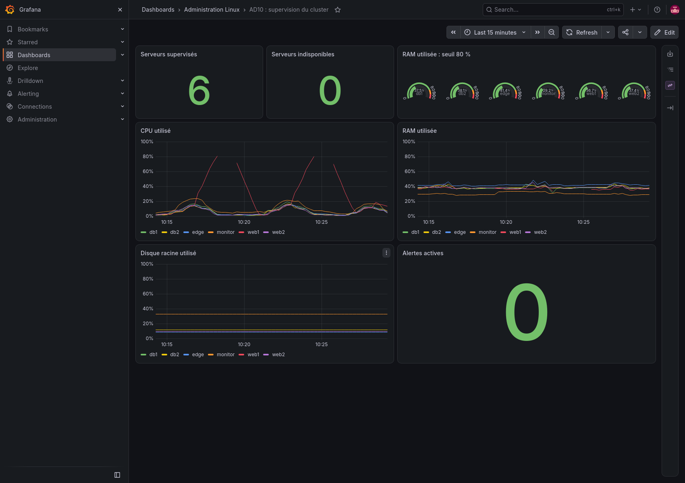

# Projet final : infrastructure sécurisée, automatisée et supervisée

## Périmètre

Le laboratoire héberge un catalogue de test sur deux serveurs web, une base MariaDB répliquée, un répartiteur HAProxy et une plateforme Prometheus/Grafana. Les six serveurs sont des VM Ubuntu dédiées. Les configurations sont déployées par Ansible et les résultats ci-dessous sont vérifiés sur l'infrastructure réelle.


## Machines et ressources

| Machine | Adresse privée | Rôle | RAM |
| --- | --- | --- | --- |
| edge | 192.168.77.20 | HAProxy, terminaison HTTPS et proxy SQL. | 768 Mio |
| web1 | 192.168.77.21 | Nginx et PHP-FPM. | 768 Mio |
| web2 | 192.168.77.22 | Nginx et PHP-FPM. | 768 Mio |
| db1 | 192.168.77.31 | MariaDB primaire et sauvegardes. | 1 Gio |
| db2 | 192.168.77.32 | MariaDB réplique en lecture seule. | 1 Gio |
| monitor | 192.168.77.50 | Prometheus, Grafana et Alertmanager. | 2 Gio |

Chaque VM utilise deux vCPU et un disque extensible de 12 Gio. Les disques sont des images différentielles : seules les modifications consomment de l'espace en plus de l'image Ubuntu commune. Les machines des TP1, TP2 et TP4 restent distinctes du cluster.

## Installation depuis un dépôt neuf

L'hôte Linux doit disposer de KVM et l'utilisateur doit avoir accès à `/dev/kvm`. Pour l'exécution depuis Windows, lancer ces commandes dans Ubuntu/WSL. Sur un autre hyperviseur, adapter l'inventaire aux adresses SSH des VM, ainsi que les interfaces `ens3`, `wan` et `lan` utilisées par le réseau et le pare-feu.

```bash
sudo apt-get update
sudo apt-get install qemu-system-x86 qemu-utils cloud-image-utils python3-venv
sudo usermod -aG kvm "$USER"
# Ouvrir une nouvelle session pour prendre en compte le groupe.
python3 -m venv .venv
.venv/bin/pip install -r requirements.txt
.venv/bin/ansible-galaxy collection install -r collections/requirements.yml
.venv/bin/playwright install firefox
sudo .venv/bin/playwright install-deps firefox

python3 lab/manage.py start edge
python3 lab/manage.py start web1
python3 lab/manage.py start web2
python3 lab/manage.py start db1
python3 lab/manage.py start db2
python3 lab/manage.py start monitor
python3 lab/manage.py wait edge
python3 lab/manage.py wait web1
python3 lab/manage.py wait web2
python3 lab/manage.py wait db1
python3 lab/manage.py wait db2
python3 lab/manage.py wait monitor

python3 lab/generate_secrets.py
python3 lab/create_tls.py
.venv/bin/ansible-playbook final/bootstrap.yml
.venv/bin/ansible-playbook final/site.yml -e ansible_user=alice
.venv/bin/python final/verify.py
```

Les chemins des fichiers supposent une exécution depuis la racine du dépôt. `bootstrap.yml` prépare Alice avec le compte initial `labadmin`. Le déploiement principal utilise ensuite Alice et lui réserve l'accès SSH. Pour les réexécutions, utiliser directement `final/site.yml -e ansible_user=alice`.

Le laboratoire télécharge une image Ubuntu officielle et compare sa somme SHA-256 à celle du serveur de publication. Les clés SSH, certificats privés, secrets et disques sont conservés dans `.lab/`, avec des permissions restrictives, et sont exclus de Git. Ne pas supprimer les secrets existants pendant une simple réexécution : cela changerait les identifiants attendus.

## Accès et chiffrement

| Usage | Adresse locale | Authentification |
| --- | --- | --- |
| Catalogue | https://localhost:8443 | Lecture publique de données de test. |
| Grafana | http://localhost:3000 | Compte admin, secret dans `.lab/secrets.json`. |
| Prometheus | http://localhost:9090 | Accès limité au poste de gestion par le pare-feu. |
| Alertmanager | http://localhost:9093 | Accès limité au poste de gestion par le pare-feu. |
| SSH | `python3 lab/manage.py ssh NOM --user alice` | Clé privée locale et compte Alice. |

Le port HTTP 8080 redirige vers HTTPS 8443. Le certificat est autosigné pour `localhost`, `127.0.0.1` et l'adresse privée de HAProxy ; le navigateur demande donc de lui faire confiance. Le contrôle automatisé utilise explicitement ce certificat comme autorité de confiance et vérifie l'identité du serveur, sans désactiver la validation TLS.

```bash
curl --cacert .lab/tls/edge.crt https://localhost:8443/
```

HAProxy impose TLS 1.2 au minimum. Les interfaces de supervision en HTTP ne sont exposées que sur les redirections locales du laboratoire ; pour les administrer depuis un autre poste, utiliser un tunnel sécurisé ou ajouter une terminaison TLS adaptée. Le certificat local doit être remplacé par un certificat reconnu pour un déploiement public.

## Sécurité réseau

Toutes les machines appliquent une politique d'entrée et de transfert `drop`. Les connexions établies, le bouclage et le DHCP de la carte de sortie sont préservés. Les flux de service sont limités par port et adresse source.

| Destination | Ports TCP | Sources autorisées |
| --- | --- | --- |
| Tous les serveurs | 22 | Gestion SSH par clé, compte Alice uniquement. |
| edge | 80, 443 | Clients du laboratoire. |
| web1, web2 | 80 | edge uniquement. |
| db1, db2 | 3306 | edge et serveur DB pair. |
| edge | 3306, 3307 | web1 et web2 uniquement. |
| Tous les exporteurs | 9100 | monitor uniquement. |
| monitor | 3000, 9090, 9093 | Adresse de gestion du NAT QEMU, `10.0.2.2`. |

Le rôle `security` réutilise la configuration SSH du TP2, fail2ban et la surveillance auditd de `/etc/passwd`. Les essais de connexion depuis le poste de gestion sont exemptés du bannissement afin de conserver l'accès au laboratoire. Les autres sources restent soumises aux trois tentatives sur dix minutes. Alice dispose de sudo sans mot de passe pour l'automatisation ; sa clé doit être protégée.

## Supervision des services

Node Exporter mesure CPU, RAM et disque sur les six VM. Un collecteur exécuté toutes les quinze secondes ajoute l'état de douze services, la disponibilité MariaDB, les deux fils de réplication, son retard et l'heure de la dernière sauvegarde. Les fichiers de métriques sont remplacés atomiquement pour éviter une lecture partielle.

Les alertes couvrent : RAM supérieure à 80 % pendant deux minutes, exporteur absent pendant une minute, service ou base indisponible pendant trente secondes, réplication interrompue pendant une minute, sauvegarde datant de plus de vingt-cinq heures et collecteur de services absent ou figé. Les notifications et résolutions sont enregistrées par le récepteur local Alertmanager.

Le déclenchement réel et la résolution de l'alerte mémoire sont prouvés au TP5. Le contrôle final vérifie la collecte des six VM, les douze états de service et les métriques de réplication et de sauvegarde.



## Sauvegarde et restauration

Le primaire exécute `/usr/local/sbin/backup-shop` chaque jour à 02 h 30 UTC via `/etc/cron.d/backup-shop`. Le script utilise `mariadb-dump --single-transaction` pour un export cohérent des tables transactionnelles. Le dump est compressé et vérifié, sous verrou, avant d'être renommé dans `/backup`. Le répertoire et les archives ne sont accessibles qu'à root. Un marqueur de succès alimente la supervision.

Le test final lance une sauvegarde, restaure le dump dans `ad10_restore_check` et compare les sommes de contrôle du catalogue original et restauré. La base temporaire est supprimée après le contrôle. [Script de contrôle](check-backup.sh).

La sauvegarde est locale et aucune rétention destructive n'est appliquée dans le laboratoire. Pour une exploitation réelle, copier les archives vers un stockage distinct, définir une rétention, chiffrer les copies et conserver les éléments de configuration nécessaires à une restauration complète. L'exécution cron de nuit n'a pas été attendue ; la commande et la restauration ont été exécutées pendant la séance.

## Vérifications finales

| Vérification | Résultat attendu et contrôlé |
| --- | --- |
| HTTPS et répartition | Certificat validé, HTTP 200 et réponses de web1 et web2. |
| Accès SSH | Alice admise ; root et labadmin refusés sur les six VM. |
| Segmentation | Accès HTTP refusé depuis une source hors proxy ; accès SQL direct refusé depuis le TP1. |
| Flux nécessaires | edge accède aux serveurs web ; les serveurs web accèdent au proxy SQL ; monitor accède aux exporteurs. |
| Panne web1 | Le site continue de répondre par web2. |
| Panne db1 | Le catalogue reste lisible sur db2. |
| Redémarrage web1 | SSH, Nginx, PHP, pare-feu, audit et exporteur reviennent automatiquement. |
| Sauvegarde | Restauration séparée et sommes de contrôle identiques. |
| Supervision | Six cibles actives, douze services disponibles et réplication opérationnelle. |
| Réexécution Ansible | Aucun changement lorsque l'état souhaité est déjà atteint. |

Les sorties réelles se trouvent dans [verification.txt](evidence/verification.txt), [deployment.txt](evidence/deployment.txt) et [la seconde exécution](evidence/idempotence.txt). Les exports nftables de chaque serveur et l'état de collecte final sont conservés dans le même dossier.

## Exploitation et diagnostic

```bash
python3 lab/manage.py status all
python3 lab/manage.py ssh edge --user alice 'sudo journalctl -u haproxy -n 50'
python3 lab/manage.py ssh web1 --user alice 'sudo nginx -t'
python3 lab/manage.py ssh db2 --user alice 'sudo mariadb -e "SHOW SLAVE STATUS\G"'
python3 lab/manage.py ssh monitor --user alice 'sudo journalctl -u prometheus -n 50'
python3 lab/manage.py ssh monitor --user alice 'sudo journalctl -u ad10-alert-receiver -n 30'
```

En cas d'alerte mémoire, vérifier les processus, la mémoire disponible et l'évolution sur le tableau de bord. Si une sonde disparaît, vérifier d'abord la VM, le service exporteur et le pare-feu. Pour une réplication interrompue, contrôler les deux fils, le retard et les erreurs de `SHOW SLAVE STATUS` avant toute modification. Pour une sauvegarde trop ancienne, examiner `/var/log/backup-shop.log`, l'espace disque et les droits, puis relancer et restaurer une archive de contrôle.

Pour arrêter proprement une machine : `python3 lab/manage.py stop NOM --user alice`. La redémarrer avec `start NOM`, puis attendre SSH avec `wait NOM --user alice`. Les disques et configurations sont conservés.

## Limites et reprise après panne

HAProxy retire automatiquement un serveur web indisponible. Pour la base, la bascule de lecture vers db2 est automatique, mais les écritures attendent le retour de db1. Le retour du primaire a été testé ; la réplication reprend automatiquement, avec un délai de reconnexion pouvant atteindre soixante secondes.

La réplication est asynchrone et ne garantit pas la conservation de toutes les dernières écritures après une perte brutale du primaire. Une promotion définitive de db2 exige d'isoler db1 avant de rendre db2 inscriptible, puis de reconstruire l'ancienne base à partir d'une sauvegarde cohérente. Cette promotion n'est pas automatisée ni incluse dans les tests livrés.

Le répartiteur et la VM de supervision constituent des points uniques de panne. Les échanges SQL restent sur le réseau privé sans TLS. Le catalogue sert à valider l'infrastructure ; il ne met pas en œuvre les fonctions métier d'une boutique. Ces limites doivent être levées avant d'héberger un commerce réel critique.

## Erreur corrigée pendant l'intégration

Le premier collecteur de réplication échouait sur les champs vides de `SHOW SLAVE STATUS`, à cause d'une séparation exigeant un espace après les deux-points. L'analyse utilise désormais le premier deux-points et accepte les valeurs vides. Les services dont l'application avait été interrompue ont été rechargés, puis le déploiement complet a été relancé. L'exécution forcée des handlers a aussi été activée dans le play final pour appliquer les configurations validées même si une autre tâche échoue.

Un second contrôle a détecté un ancien processus d'écoute SSH conservant l'ancienne configuration malgré le rechargement du processus principal. Le handler recharge maintenant tous les processus `sshd` portant le titre `[listener]` avec SIGHUP, sans cibler les sessions clientes. Les tests vérifient ensuite les refus réels des comptes root et labadmin sur chaque machine.

Le premier redémarrage a aussi révélé une attente réseau de deux minutes. Le laboratoire utilise IPv4 : l'attente systemd cible désormais explicitement une adresse IPv4 routable sur `ens3`, avec un délai maximal de trente secondes. L'acceptation des annonces IPv6 est désactivée dans netplan. Le contrôle après redémarrage vérifie aussi la réussite de l'attente réseau.
