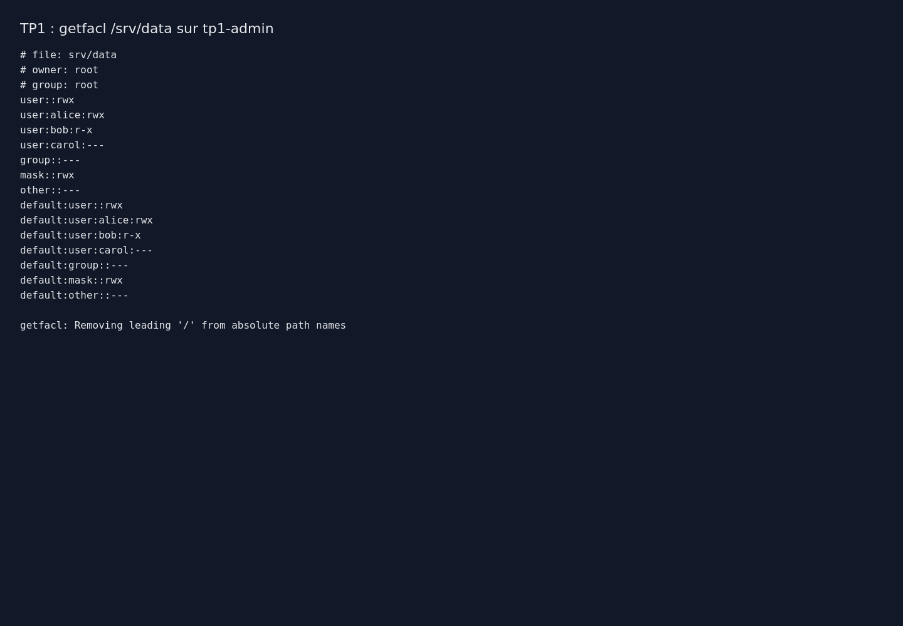

# TP1 : administration système avancée

## Environnement

Exécution le 28 octobre 2026 sur `tp1-admin`, VM Ubuntu 24.04.5 LTS, noyau `6.8.0-147-generic`, 2 vCPU et 768 Mio de RAM. `systemd-detect-virt` retourne `kvm`.

## Installation et commandes

Depuis la racine du dépôt :

```bash
python3 lab/manage.py start tp1-admin
python3 lab/manage.py wait tp1-admin
tar -cf - tp1 | python3 lab/manage.py ssh tp1-admin 'tar -xf -'
python3 lab/manage.py ssh tp1-admin 'sudo bash tp1/setup.sh'
python3 lab/manage.py ssh tp1-admin 'sudo bash tp1/verify.sh'
```

Le script installe `acl`, `cron`, `stress-ng` et `procps`, puis crée Alice, Bob et Carol si leurs comptes sont absents. Les modifications concernent `/srv/data`, `/backup`, `/usr/local/sbin/backup-data` et `/etc/cron.d/backup-data`.

## Permissions

`/srv/data` appartient à root. Les ACL nominatives accordent `rwx` à Alice, `r-x` à Bob et `---` à Carol. Le droit `x` permet à Bob de traverser le répertoire pour lire les fichiers ; il ne lui donne pas le droit d'écrire. Le groupe propriétaire et les autres utilisateurs n'ont aucun accès. Les ACL par défaut transmettent ces règles aux nouveaux éléments. Les fichiers ordinaires créés sans droit d'exécution restent non exécutables.

```bash
setfacl -m u:alice:rwx,u:bob:r-x,u:carol:---,m::rwx /srv/data
setfacl -d -m u::rwx,u:alice:rwx,u:bob:r-x,u:carol:---,g::---,m::rwx,o::--- /srv/data
getfacl /srv/data
```

Alice a créé `check.txt`. Bob a lu son contenu ; sa tentative de création de fichier a retourné `Permission denied`. Carol n'a pas pu lister le répertoire. Ces refus sont les résultats attendus.



## Sauvegarde

La tâche s'exécute quotidiennement à 02 h 00 dans le fuseau de la VM, UTC pendant le test. Le script utilise un verrou `flock` pour éviter les exécutions concurrentes. Il crée une archive temporaire, contrôle sa lisibilité, puis la renomme. `umask 077` et les permissions de `/backup` protègent les archives. `tar --acls --xattrs --numeric-owner` conserve les ACL, attributs et propriétaires.

Le contrôle a lancé la sauvegarde manuellement, extrait l'archive dans un répertoire temporaire et comparé le fichier avec `cmp`, puis les ACL avec `diff`. Les deux comparaisons ont réussi. Le service cron était actif. L'exécution à 02 h 00 n'a pas été attendue pendant cette séance ; sa configuration est livrée dans [backup.cron](backup.cron).

La sauvegarde reste locale : une panne du disque de la VM pourrait supprimer données et archives. Une exploitation réelle demande aussi une copie sur un stockage distinct, une politique de rétention et des restaurations régulières.

## Gestion de charge

La commande `top -b -n 1` a été exécutée avant et pendant `stress-ng --cpu 2 --timeout 15s`. Avant la charge, le CPU était inactif à 95,2 %. Pendant le test, chaque travailleur utilisait environ 100 % d'un vCPU.

`renice -n 10` a été appliqué au processus principal et aux deux travailleurs. `ps` a confirmé `NI=10`, et `top` a affiché `PR=30` et `NI=10`. Une valeur nice plus élevée réduit la priorité relative lorsque plusieurs processus se disputent le CPU. Elle ne fixe pas un plafond d'utilisation : les travailleurs ont donc continué à utiliser les CPU disponibles. Le processus de charge s'est terminé après 15 secondes.

## Erreurs et résolution

Le premier amorçage du laboratoire a échoué pendant la création du compte initial `operator` par cloud-init. Ce compte a été remplacé par `labadmin` et la VM recréée. La nouvelle empreinte SSH a ensuite remplacé celle de cette VM jetable dans le fichier `known_hosts` propre au laboratoire. Le second amorçage a terminé avec `cloud-init status: done`.

## Livrables et preuves

- [Configuration et installation](setup.sh).
- [Script de sauvegarde](backup.sh) et [tâche cron](backup.cron).
- [Vérifications reproductibles](verify.sh).
- [Sortie complète des vérifications](evidence/verification.txt).
- [Sortie brute de getfacl](evidence/getfacl.txt) et capture de cette sortie affichée dans un navigateur.

Les vérifications des accès, de la restauration et de la priorité ont réussi. Les fichiers sous `evidence/` proviennent de l'exécution dans la VM.
