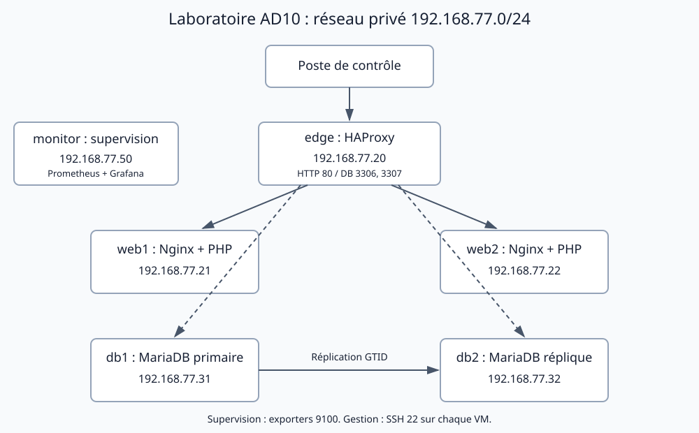
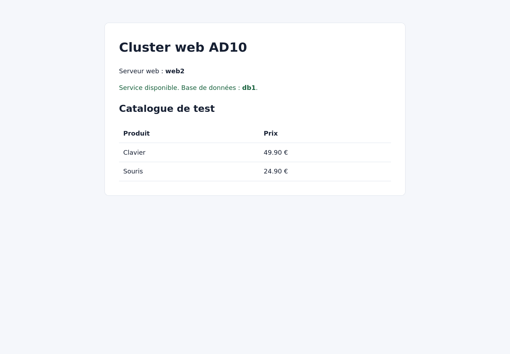

# TP3 : services réseau et haute disponibilité

## Architecture

Le cluster comprend cinq VM Ubuntu 24.04.5 LTS : deux serveurs Nginx/PHP, deux serveurs MariaDB et un répartiteur HAProxy. Le réseau de service est distinct de la carte utilisée pour télécharger les paquets. Les contrôles ont été exécutés le 28 octobre 2026.



Le serveur de supervision représenté sur le schéma est ajouté au TP5. Les échanges applicatifs passent par `edge`. Le port 3306 dirige les écritures vers le primaire ; 3307 dirige les lectures vers le primaire, puis vers la réplique s'il est indisponible.

## Déploiement

```bash
python3 lab/manage.py start edge
python3 lab/manage.py start web1
python3 lab/manage.py start web2
python3 lab/manage.py start db1
python3 lab/manage.py start db2
python3 lab/generate_secrets.py
.venv/bin/ansible-galaxy collection install -r collections/requirements.yml
.venv/bin/ansible-playbook tp3/deploy.yml
python3 tp3/verify.py
```

Attendre la fin de cloud-init avec `python3 lab/manage.py wait NOM` avant le déploiement. Les commandes Ansible se lancent depuis la racine du dépôt. [Inventaire](../lab/inventory.ini), [playbook](deploy.yml) et [résultat du déploiement](evidence/deployment.txt).

Les secrets aléatoires sont créés dans `.lab/secrets.json`, avec des permissions `0600`. Ils restent exclus de Git. Les tâches qui manipulent ces valeurs utilisent `no_log`. Le compte applicatif `shop_app` ne peut se connecter qu'à partir de l'adresse du proxy et possède les droits `SELECT`, `INSERT` et `UPDATE` sur `shop`.

## Réplication MariaDB

Chaque serveur possède un identifiant unique : 31 pour db1 et 32 pour db2. Les journaux binaires utilisent le format ROW et la réplication utilise les GTID. Le compte `replication`, limité à l'adresse de db2, ne possède que `REPLICATION SLAVE`. La réplique utilise `read_only=ON`.

La réplication est démarrée avant la création du catalogue sur une installation neuve. Les deux bases ont reçu une valeur de contrôle unique ; sa présence sur db2 prouve la transmission des écritures. `SHOW SLAVE STATUS` a confirmé `Slave_IO_Running: Yes`, `Slave_SQL_Running: Yes` et `Seconds_Behind_Master: 0`.

Cette initialisation suppose une réplique neuve et des journaux binaires disponibles depuis la création des données. Pour réintégrer une ancienne base ou une réplique ayant perdu des journaux, il faut d'abord restaurer une sauvegarde cohérente. Le playbook ne réinitialise pas une réplication existante.

## HAProxy et serveurs web

Le backend web utilise `roundrobin`. Les sondes HTTP sur `/health`, toutes les secondes, retirent un serveur après deux échecs et le réintègrent après deux réussites. La page PHP affiche le serveur web, la base interrogée et un catalogue lu dans MariaDB. Le fichier contenant le mot de passe applicatif se trouve hors de la racine web, dans `/etc/ad10-app.php`, lisible seulement par root et le groupe du service web.

La page est accessible sur [localhost:8080](http://localhost:8080). Le port est redirigé vers HAProxy ; il n'est pas exposé au réseau public. [Configuration HAProxy réellement déployée](evidence/haproxy.cfg).



## Tests de résilience

| Test | Résultat observé |
| --- | --- |
| 12 requêtes en fonctionnement normal | Réponses des deux serveurs web, code HTTP 200. |
| Arrêt de Nginx sur web1 | Les requêtes suivantes sont traitées par web2. |
| Retour de web1 | Les deux serveurs participent à nouveau. |
| Arrêt de MariaDB sur db1 | Le catalogue reste lisible depuis db2. |
| Lecture du mode de db2 pendant la panne | `read_only=1`, sans promotion automatique. |
| Retour de db1 | Reprise des deux fils de réplication et du fonctionnement normal. |

Le délai de reconnexion MariaDB par défaut est de 60 secondes. La reprise de réplication peut donc être plus lente que le retrait d'un serveur par HAProxy. Les fichiers de preuve contiennent les observations pendant cette attente.

La réplication est asynchrone : une écriture récente peut ne pas avoir atteint db2 lors d'une panne brutale. Les lectures peuvent continuer sur db2, mais les écritures nécessitent le primaire. Une réplication simple ne constitue donc pas une promotion automatique de base. HAProxy et son hôte restent aussi un point unique de panne dans ce laboratoire.

## Erreurs corrigées

Le module Ansible installé accepte `primary_use_gtid: replica_pos` et le traduit pour MariaDB ; la valeur historique `slave_pos` a été remplacée. Le rechargement de Nginx a également été corrigé : la validation et le rechargement écoutent maintenant la même notification, car une validation sans changement ne déclenche pas un second handler.

## Preuves

[Sortie complète des tests](evidence/verification.txt). Les essais arrêtent réellement les services, puis les redémarrent dans un bloc de nettoyage pour remettre le laboratoire en état.

Références : [réplication MariaDB](https://mariadb.com/docs/server/ha-and-performance/standard-replication/setting-up-replication), [sondes HAProxy](https://www.haproxy.com/documentation/haproxy-configuration-tutorials/reliability/health-checks/).
