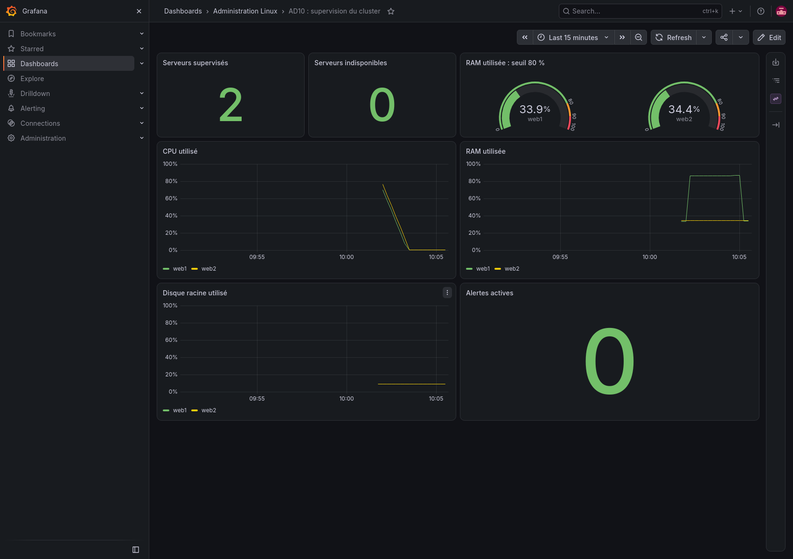
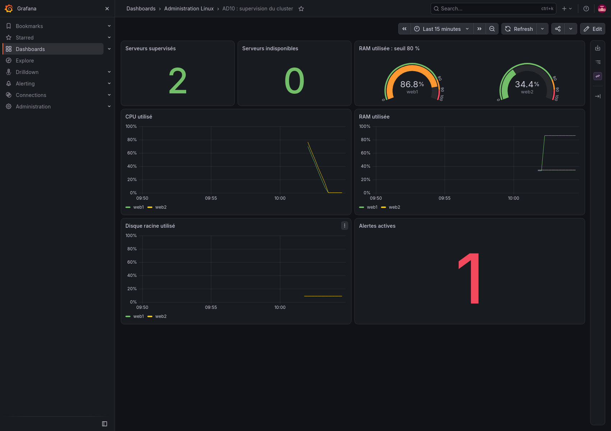

# TP5 : supervision et monitoring

## Installation

Une VM dédiée, `monitor` (`192.168.77.50`, 2 vCPU, 2 Gio de RAM), héberge Prometheus, Grafana et Alertmanager. Les serveurs web du TP3 exposent leurs mesures avec Node Exporter sur le réseau privé. Les tests ont été réalisés le 28 octobre 2026.

```bash
python3 lab/manage.py start monitor
python3 lab/manage.py wait monitor
.venv/bin/ansible-playbook tp5/deploy.yml
.venv/bin/python tp5/verify.py
```

Le rôle utilise les paquets Ubuntu pour Prometheus, Alertmanager et Node Exporter. Grafana OSS provient de son dépôt APT officiel, avec une clé dédiée et `signed-by`. Les versions réellement installées figurent à la fin du journal de vérification.

## Collecte et tableau de bord

[Configuration Prometheus](evidence/prometheus.yml). Les mesures sont collectées toutes les 15 secondes ; les règles sont aussi évaluées toutes les 15 secondes. La rétention locale est de sept jours. Les cibles web1 et web2 possèdent une étiquette `host` pour faciliter les comparaisons.

Grafana est provisionné par fichiers : une source Prometheus et un [tableau de bord personnalisé](../roles/monitoring/files/dashboard.json) à sept panneaux. Il affiche le nombre de serveurs disponibles et indisponibles, les pourcentages CPU, RAM et disque, ainsi que les alertes actives. Les requêtes CPU utilisent `rate` sur deux minutes ; quelques échantillons sont donc nécessaires après le démarrage.

Les interfaces locales sont [Grafana](http://localhost:3000), [Prometheus](http://localhost:9090) et [Alertmanager](http://localhost:9093). Grafana exige une connexion avec le compte `admin` ; son mot de passe aléatoire est conservé dans `.lab/secrets.json` et n'est pas publié. Le tableau de bord n'autorise pas l'accès anonyme.



## Stratégie d'alerte mémoire

La règle [MemoryUsageHigh](../roles/monitoring/files/alerts.yml) utilise :

```promql
(1 - node_memory_MemAvailable_bytes / node_memory_MemTotal_bytes) * 100 > 80
```

`MemAvailable` tient compte de la mémoire récupérable par Linux ; cette mesure évite de considérer tout le cache comme une consommation irréversible. Le seuil est strictement supérieur à 80 %. Le délai `for: 2m` filtre les pointes courtes. L'état devient `pending`, puis `firing` si le dépassement dure deux minutes. Il se résout quand la condition cesse d'être vraie.

Alertmanager groupe les événements par nom d'alerte et serveur, attend cinq secondes avant la première notification et répète une alerte persistante après une heure. Le récepteur HTTP local enregistre les notifications dans journald, y compris les résolutions. Aucun destinataire externe n'est configuré dans le laboratoire. Une exploitation réelle doit raccorder ce récepteur à la chaîne d'astreinte de l'équipe.

Une seconde règle, `NodeUnavailable`, détecte la perte d'un exporteur pendant une minute.

## Vérifications

Les tests `promtool` vérifient quatre situations : 80 % sans alerte, 85 % pendant moins de deux minutes sans notification active, 85 % pendant deux minutes avec alerte, puis retour sous le seuil avec résolution. Les tests ont réussi.

Un essai réel a ensuite alloué et touché des pages mémoire sur web1 pour laisser environ 13 % de mémoire disponible. Le processus était limité à 600 Mio par systemd et à 250 secondes d'exécution. Prometheus a observé les états `pending` puis `firing`. Alertmanager a reçu l'événement, et la capture ci-dessous a été prise pendant le dépassement.



Le processus de test a été arrêté dans un bloc de nettoyage. Après libération de la mémoire, l'alerte s'est résolue. Le journal du récepteur confirme les notifications `firing` et `resolved`.

## Livrables

- [Playbook](deploy.yml), [rôle de supervision](../roles/monitoring/) et [rôle Node Exporter](../roles/node_exporter/).
- [Déploiement réel](evidence/deployment.txt) et [vérifications complètes](evidence/verification.txt).
- [Cibles collectées](evidence/targets.json).
- [Alerte active Prometheus](evidence/alerts-firing.json) et [réception Alertmanager](evidence/alertmanager.json).
- [Notifications de déclenchement et de résolution](evidence/notification-journal.txt).

Aucune erreur n'a été observée pendant le déploiement de la supervision. Un avertissement Ansible a signalé la création de son répertoire temporaire root avec des permissions `0700` ; le déploiement a continué normalement.

Références : [installation officielle Grafana](https://grafana.com/docs/grafana/latest/setup-grafana/installation/debian/), [provisionnement Grafana](https://grafana.com/docs/grafana/latest/administration/provisioning/), [règles d'alerte Prometheus](https://prometheus.io/docs/prometheus/latest/configuration/alerting_rules/).
